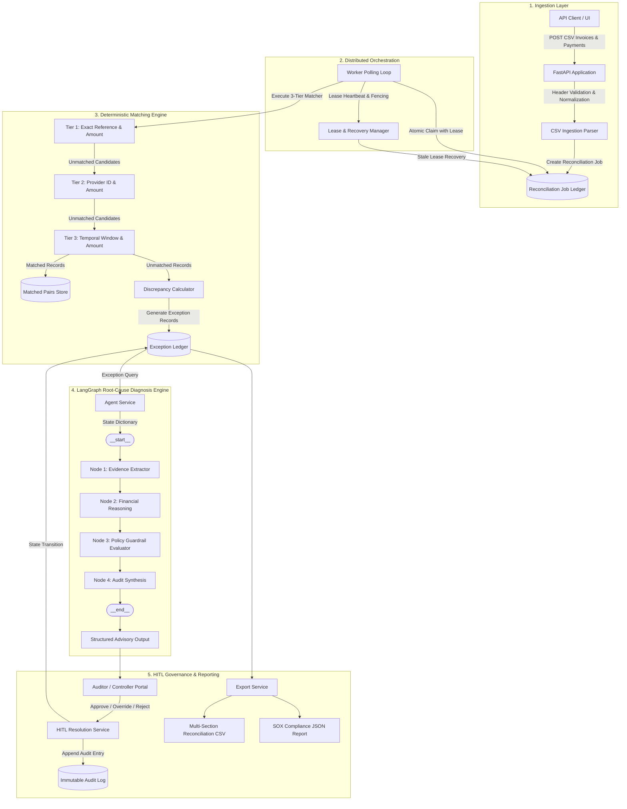
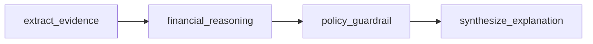
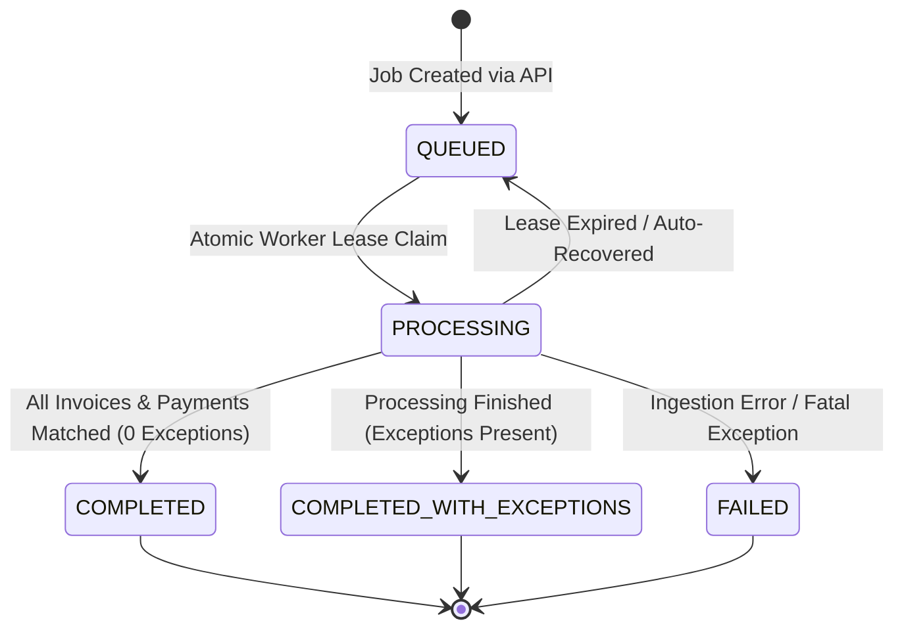
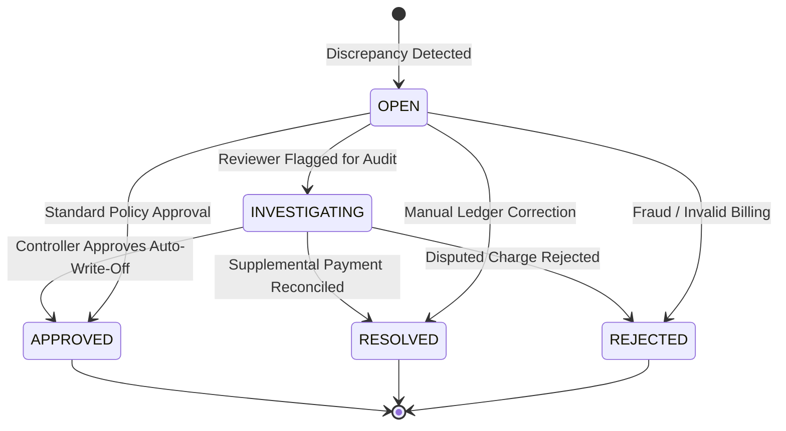

# Autonomous Financial Reconciliation Agent (AFRA)

AFRA is an enterprise-grade financial reconciliation system engineered to match accounts payable and accounts receivable records with mathematical determinism, orchestrate distributed batch processing with lease fencing, enforce multi-tenant isolation, and triage financial discrepancies using a structured LangGraph state machine.

---

## 1. Executive Summary and Design Philosophy

Financial reconciliation is a mission-critical accounting process subject to strict regulatory compliance, including the Sarbanes-Oxley Act (SOX). Traditional manual reconciliation suffers from high operational overhead, human error, and delayed month-end closes. Conversely, unconstrained machine learning or pure large language model (LLM) architectures introduce non-deterministic risks, such as numerical hallucinations and unverifiable ledger mutations.

AFRA resolves this dilemma through a hybrid architecture:
1. **Deterministic Core**: All transaction parsing, arithmetic calculations, and invoice-to-payment matching are executed using exact fixed-point arithmetic (`Decimal`) and deterministic rule hierarchies.
2. **LangGraph Root-Cause Diagnosis**: Discrepancies and exceptions are analyzed through a multi-node LangGraph StateGraph that correlates transaction context against corporate policies and accounting heuristics.
3. **Immutable Audit Ledger**: Every system decision, automated adjustment, and Human-in-the-Loop (HITL) resolution is persisted into an append-only audit trail.
4. **Distributed Lease Fencing**: Background workers coordinate reconciliation jobs using atomic lease claims and expiration recovery to prevent double-processing in multi-instance deployments.

---

## 2. System Architecture

The following diagram illustrates the complete system architecture, spanning client ingestion, worker leasing, deterministic matching, the LangGraph diagnosis engine, and audit logging.



---

## 3. Core Engine Components

### 3.1. Deterministic 3-Tier Matcher
Matching executes sequentially across three deterministic tiers. Once a payment or invoice is consumed in a tier, it is removed from the candidate pool to prevent ambiguous or duplicate settlements.

- **Tier 1 (Exact Match)**: Matches identical invoice identifiers and payment references where monetary amounts align within exact tolerance limits ($0.00 variance by default).
- **Tier 2 (Provider Reference Match)**: Matches transactions sharing identical provider transaction references and exact monetary values.
- **Tier 3 (Composite Temporal Window Match)**: Matches remaining transactions by matching exact currency and amount criteria within a bounded sliding date window (default: +/- 3 business days).

### 3.2. Fixed-Point Precision
To prevent binary floating-point representation anomalies (such as `0.1 + 0.2 != 0.3`), all monetary computations are quantized using Python `Decimal` with fixed penny precision (`Decimal("0.01")`). Arithmetic mismatches immediately fail validation prior to database entry.

### 3.3. LangGraph StateGraph Architecture
When discrepancies occur, the exception is handed to a 4-node directed graph implemented via LangGraph (`StateGraph`):



- **`extract_evidence`**: Extracts structured parameters from raw transaction metadata, normalizing amount, timestamp, entity references, and caller-supplied context into verifiable evidence citations.
- **`financial_reasoning`**: Applies systematic accounting hypotheses to deduce discrepancy causes, identifying VAT/tax rounding variances ($\le \$1.00$), intermediary bank wire deductions ($15, $25, $30, etc.), currency conversion variances, or partial customer payments.
- **`policy_guardrail`**: Validates the hypothesis against corporate SOX policies. Discrepancies meeting micro-tolerance thresholds ($\le \$50.00$) qualify for auto-adjustment recommendations; discrepancies exceeding thresholds trigger mandatory escalation.
- **`synthesize_explanation`**: Compiles the unified explanation schema with confidence scores and evidence citations for auditor presentation.

---

## 4. State Machines and Lifecycle Management

### 4.1. Reconciliation Job Lifecycle
Jobs transition through an explicit finite state machine. Terminal states (`COMPLETED`, `COMPLETED_WITH_EXCEPTIONS`, `FAILED`) are strictly protected against illegal mutations.



### 4.2. Exception Record Lifecycle
Exceptions require human intervention or automated policy resolution:



---

## 5. Security, RBAC, and Tenant Isolation

- **Tenant Isolation**: Every database entity (`ReconciliationJob`, `ExceptionRecord`, `AuditLog`) enforces a foreign key association with a verified `tenant_id`. Queries strictly filter on the authenticated caller's tenant context. Cross-tenant reads and mutations return `404 Not Found` or `403 Forbidden`.
- **Role-Based Access Control (RBAC)**:
  - **Admin**: Full platform administrative rights, job recovery invocation, configuration updates.
  - **Operator**: Job creation, file uploads, viewing reconciliation summaries. Restricted from closing or overriding financial exceptions.
  - **Auditor**: Full read access across jobs, exception details, and immutable audit trails. Read-only permissions.
- **Authentication**: Bearer token authorization validated via HTTP headers and FastAPI dependency injection (`HTTPBearer(auto_error=False)`).

---

## 6. Repository Layout

```
.
├── Dockerfile                      # Production container specification (non-root user)
├── docker-compose.yml              # Multi-container service definition
├── pyproject.toml                  # Project packaging and dependency constraints
├── app/
│   ├── main.py                     # Application entry point and lifespan handlers
│   ├── dependencies.py             # Database sessions and security dependencies
│   ├── agent/
│   │   ├── graph.py                # LangGraph StateGraph multi-node implementation
│   │   └── engine.py               # FinancialExplanationAgent abstraction
│   ├── api/
│   │   ├── router.py               # Aggregated API route definitions
│   │   └── v1/
│   │       ├── reconciliations.py  # Ingestion and job monitoring endpoints
│   │       ├── hitl.py             # Human-in-the-Loop review and audit endpoints
│   │       └── exports.py          # CSV and JSON compliance export routes
│   ├── core/
│   │   ├── config.py               # Pydantic environment settings
│   │   └── security.py             # API key verification and RBAC enforcement
│   ├── domain/
│   │   ├── enums.py                # JobStatus, ExceptionStatus, UserRole enumerations
│   │   ├── money.py                # Fixed-point decimal arithmetic utilities
│   │   └── transitions.py          # State machine boundary enforcement
│   ├── ingestion/
│   │   └── csv_parser.py           # Resilient CSV parser with whitespace normalization
│   ├── persistence/
│   │   ├── database.py             # SQLAlchemy engine and session factory
│   │   └── models/
│   │       ├── all_models.py       # Job, Invoice, Payment, and Exception schemas
│   │       └── audit.py            # Immutable AuditLog ledger model
│   ├── reconciliation/
│   │   ├── matcher.py              # Deterministic 3-tier matching engine
│   │   └── calculator.py           # Discrepancy and variance computation
│   ├── reporting/
│   │   ├── export_service.py       # Multi-section reconciliation CSV generator
│   │   └── json_report.py          # Structured SOX compliance JSON generator
│   ├── services/
│   │   ├── agent_service.py        # LangGraph bridge with audit logging
│   │   └── hitl_service.py         # Exception resolution logic and audit tracking
│   └── workflows/
│       ├── runner.py               # Batch job worker execution loop
│       └── recovery.py             # Distributed lease expiration recovery
└── tests/
    ├── api/                        # Integration test suite for HTTP endpoints
    └── unit/                       # Unit tests for matching, leasing, and LangGraph
```

---

## 7. Installation and Local Setup

### 7.1. Prerequisites
- Python 3.12 or higher
- SQLite 3 (or PostgreSQL for enterprise deployments)

### 7.2. Environment Setup

1. Clone repository and create a Python virtual environment:
```bash
git clone https://github.com/Arunpurohit1766/Autonomous-Financial-Reconcilation-Agent.git
cd Autonomous-Financial-Reconcilation-Agent
python3.12 -m venv .venv
source .venv/bin/activate
```

2. Install dependencies:
```bash
pip install --upgrade pip
pip install -r <(python -c "
import tomllib
with open('pyproject.toml', 'rb') as f:
    data = tomllib.load(f)
for dep in data['project']['dependencies']:
    print(dep)
")
pip install "langgraph>=0.2.0" "langchain-core>=0.3.0"
```

3. Configure environment variables:
```bash
cp .env.example .env
```

Key environment configurations in `.env`:
```ini
ENVIRONMENT=production
DATABASE_URL=sqlite:///./afra.db
API_KEY_ADMIN=key_admin_alpha
API_KEY_OPERATOR=key_operator_beta
API_KEY_AUDITOR=key_auditor_gamma
LEASE_TIMEOUT_SECONDS=300
```

---

## 8. Running the Application

### 8.1. Local Development Server
```bash
uvicorn app.main:app --host 0.0.0.0 --port 8000 --reload
```
Interactive Swagger documentation is available at `http://localhost:8000/docs`.

### 8.2. Container Deployment
AFRA includes a production-hardened Dockerfile executing under a non-root security context (`appuser:10001`):

```bash
docker build -t afra-service:latest .
docker run -p 8000:8000 --env-file .env afra-service:latest
```

---

## 9. API Reference

### 9.1. Ingestion and Jobs
- `POST /api/v1/reconciliations/upload`
  - Ingests invoice and payment CSV files.
  - Rejects empty payloads, malformed headers, or zero-row data.
  - Returns `202 Accepted` with a `job_id`.
- `GET /api/v1/reconciliations/{job_id}`
  - Returns current job status, matched count, exception count, and timestamps.

### 9.2. Human-in-the-Loop (HITL)
- `GET /api/v1/hitl/exceptions?job_id={id}`
  - Lists open exceptions scoped to the caller's tenant.
- `POST /api/v1/hitl/exceptions/{exception_id}/explain`
  - Invokes the LangGraph StateGraph engine to diagnose root causes and suggest accounting adjustments.
- `POST /api/v1/hitl/exceptions/{exception_id}/resolve`
  - Applies reviewer decisions (`APPROVE`, `RESOLVE`, `REJECT`, `OVERRIDE`, `INVESTIGATE`).
  - Automatically writes an immutable audit record to `audit_logs`.
- `GET /api/v1/hitl/audit/{target_id}`
  - Retrieves the complete audit history for a job or exception record.

### 9.3. Governance and Exports
- `GET /api/v1/exports/{job_id}/csv`
  - Generates a multi-section CSV report containing Summary, Matched Items, Exceptions, and Ingestion Errors.
- `GET /api/v1/exports/{job_id}/json`
  - Generates a structured JSON payload for downstream enterprise ERP ingestion and SOX compliance filings.

---

## 10. Verification and Test Suite

The test suite consists of 49 automated unit and API integration tests covering contracts, matching, leasing, RBAC, export generation, and LangGraph node orchestration.

Run the test suite:
```bash
python -m pytest -v
```

### Coverage Distribution
- `tests/unit/test_phase0_contracts.py`: Monetary quantization, state machine boundaries, schema validations.
- `tests/unit/test_phase1_engine.py`: 3-tier matcher logic, temporal windows, CSV whitespace normalization.
- `tests/unit/test_phase2_hardening.py` & `test_phase2_worker_fencing.py`: Distributed lease claims, worker race prevention, expired lease recovery.
- `tests/unit/test_phase4_agent.py` & `test_langgraph_agent.py`: LangGraph StateGraph topology, node execution, tolerance thresholds, and advisory generation.
- `tests/api/test_release_gate.py`: Multi-tenant boundary isolation, RBAC role gating, and readiness probe resilience.

---

## 11. Compliance and Audit Standard

AFRA enforces compliance controls aligned with internal financial audit standards:
- **Separation of Duties**: Operational users cannot resolve exceptions without auditor/admin role assignments.
- **Append-Only Auditing**: The `audit_logs` table has no application-level update or delete endpoints.
- **Traceable Reasoning**: Every automated suggestion is attributed to a specific engine provider (`langgraph-multi-node-agent`) and stored with factual citations.

---

## Author and Contact

**Developed and Architected by:** Arun Purohit   
- **Project Repository:** [Autonomous-Financial-Reconcilation-Agent](https://github.com/Arunpurohit1766/Autonomous-Financial-Reconcilation-Agent)  
- **Technical Focus:** Distributed Systems, Financial Engineering, Deterministic Reconciliation, and Agentic Workflow Automation